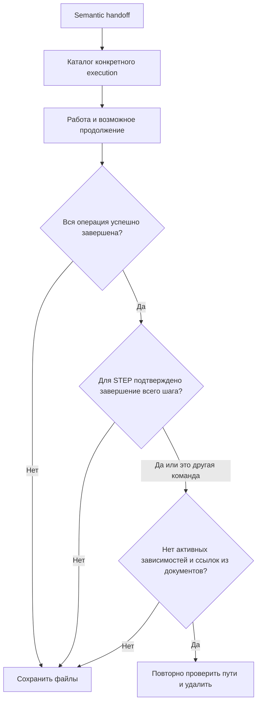

# Временные рабочие файлы

Harness выдаёт агенту `temporaryDirectory` в semantic handoff: `.harness/local/tmp/<executionId>/`. Здесь хранятся новые снимки «до», вспомогательные скрипты, patches и промежуточные логи. Повторный handoff и resume возвращают тот же каталог. Создавать произвольные `step-*-implement` рядом больше не требуется.

Evidence в STEP, неизменяемые отчёты review, Verification proofs и данные восстановления должны жить вне `tmp`, у своих существующих владельцев. Ссылка из canonical документа защищает временные файлы от удаления, но превращать tmp в постоянное хранилище не следует.

## Кто владеет каталогом

Владелец — существующая execution из `.harness/local/execution/execution-status.json`. Маркер `.harness-owner.json` содержит `schemaVersion: 1`, её `executionId` и identity каталога. Маркер не заменяет execution state и не служит самостоятельным доказательством завершения. Занятый неизвестный каталог, скопированный маркер или ссылка не принимаются как собственность Harness.

Отдельного глобального реестра нет. Если terminal record уже исключён из ограниченной истории, каталог сохраняется с `OWNER_PROOF_MISSING`. Возраст файла и отсутствие execution не являются разрешением на удаление. Схема execution state не меняется.

## Когда удаляются файлы

Автоматическая очистка запускается после успешного terminal checkpoint dispatcher, включая восстановленное завершение. Проверка и удаление используют общий модуль `local_cleanup.py`.

Для обычной команды требуется успешное завершение всей корневой команды или явно заданной цепочки. Для STEP дополнительно требуется действующий `step_completion_proof` всего шага. Успешный PLAN или IMPLEMENT внутри ещё не завершённого STEP не разрешает уборку. Cleaner не повторяет продуктовые тесты или review.

Running, blocked и failed владельцы сохраняют свои файлы. Активное выполнение того же STEP или прямая зависимость от execution также защищают каталог. Проверяются configured `sources` и `protocol` paths, каталог update reports и явные `STEP.architecture_refs` вне этих корней; ссылка на путь временного каталога в документе сохраняет его. Поле `execution_id` в происхождении отчёта само по себе не является ссылкой на временные файлы. Невозможность прочитать необходимые документы запрещает удаление.

## Явные команды

- `HARNESS CLEANUP CHECK` показывает кандидатов, суммарные файлы/байты допустимых кандидатов и причины сохранения. Не создаёт lock, execution, журнал или отчёт.
- `HARNESS CLEANUP APPLY` заново вычисляет кандидатов и перед каждым удалением повторяет проверку. Результат прошлого CHECK не используется как разрешение.

Обе команды выполняет dispatcher без semantic skill. CLI для диагностики: `python3 .harness/tools/local-cleanup.py check` и `python3 .harness/tools/local-cleanup.py apply`. JSON возвращает `candidates`, `files`, `bytes`; у кандидата есть `path`, `eligible`, `reasonCode`, а после APPLY — `removed`. Exit code `0` означает выполненную проверку/очистку, `2` — предупреждение.

Основные причины сохранения: `OWNER_NOT_COMPLETE`, `STEP_NOT_COMPLETE`, `ACTIVE_DEPENDENCY`, `CANONICAL_REFERENCE`, `REFERENCES_UNAVAILABLE`, `OWNER_PROOF_MISSING`, `UNKNOWN_OWNER`, `UNSAFE_LINK`, `LOCK_FILE`, `CANDIDATE_CHANGED`.

## Границы безопасности

APPLY держит существующий execution lock от чтения state до удаления. Это исключает одновременный canonical resume или начало update transaction. Активный update запрещает APPLY. CHECK остаётся read-only.

Удаляются только подтверждённые каталоги внутри `.harness/local/tmp/`. Parent/leaf symlinks, Windows junctions/reparse points, необычные типы файлов и lock files сохраняются. Identity и состав дерева проверяются повторно. На POSIX каталог сначала атомарно перемещается в случайный закрытый `.cleanup-*` внутри tmp, проверяется целиком, затем удаляется через открытые directory descriptors; на Windows — handles, запрещающие подмену пути, и удаление через тот же handle.

Ошибка вторичной уборки возвращается в `cleanup` как предупреждение и не отменяет основной SUCCESS. После crash между completion и уборкой повторный APPLY может удалить остаток, пока authoritative proof доступен. Частичный сбой сохраняет оставшееся для диагностики; повторный вызов безопасен.

Старые `step-*`, `reconcile-*`, файлы непосредственно в `local`, а также `execution`, `git`, `update-journal`, `verification-proofs`, `verification-resume`, `product-verification` и другие namespaces не входят в cleaner. Их нельзя удалять или переносить по одному имени или возрасту. TTL, квоты и фоновая очистка не вводятся.

При ошибке после POSIX capture остаток сохраняется в указанном `.cleanup-*`; cleaner не перезаписывает занятое исходное имя и не удаляет такой неизвестный остаток автоматически. Это защищает от обычных writers старого пути. Процесс того же пользователя, намеренно работающий с приватным quarantine, или writer с заранее открытым descriptor внутрь дерева не изолируется средствами POSIX; таких writers следует завершить до уборки. Recovery/execution lock защищает штатные операции Harness, а не произвольные процессы с теми же правами.
